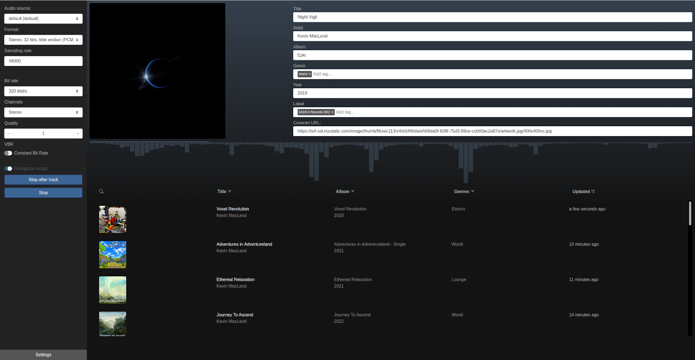

# Audio Dragon

AudioDragon is an application to record, tag and save audio played back by your system.

## Features

- Records audio via the Java Sound API, including loopback devices such as Stereomix (if supported by your system).
- Optional Linux PipeWire backend records system playback monitors with 16-, 24- or 32-bit integer PCM.
- Automatic splitting of songs at track boundaries.
- Recognition of playing track via the Shazam™ and MusicBrainz™ APIs.
- Saving of tracks as MP3 files.
- Track information as ID3 header in MP3 files.
- Filterable library of recorded tracks.
- Visualization of frequencies for a nicer look ;)

> This project is currently under development. It contains bugs and may not be usable at all on some machines.
> Please do not report issues yet.



## Recording system audio on Linux with PipeWire

The optional `pipewire` backend captures playback through PipeWire's PulseAudio
compatibility service (`pipewire-pulse`). It uses `pactl` to discover output monitors
and `parec` to record them; no native Java bindings are required. It also works with
a PulseAudio server. Java Sound remains available and is still the default backend.

On Linux Mint 22.x, install the command-line tools if needed:

```sh
sudo apt install pulseaudio-utils
```

Run AudioDragon as your desktop user, with access to that user's audio server.
Check connectivity and available outputs with:

```sh
pactl info
pactl --format=json list sinks
systemctl --user status pipewire-pulse
```

In the existing `~/.audiodragon.json` settings file, change only
`recording.platform` from `"java-audio"` to `"pipewire"`, preserving the other
settings, then restart AudioDragon. If the file does not exist yet, save settings
once in the application to create it. Return to `"java-audio"` and restart to use
the original backend.

Select **Monitor of …** for the output carrying the audio you want to capture.
The backend captures all applications routed to that output, not microphones or
all outputs combined. After switching headphones or other playback devices, stop
recording and select the new output. There is no automatic device switching or
reconnection if the server or device disappears.

The preferred format is **32-bit signed little-endian stereo PCM**, at the output's
reported sample rate (48 kHz if unavailable). Packed 24-bit and 16-bit PCM and mono
are also selectable. The sample rate remains editable; matching the output's rate
avoids unnecessary capture resampling. PipeWire handles format/channel conversion.
The backend preserves the captured PCM bytes in its recording buffers; analysis
and recognition conversions do not replace the stored PCM.

Higher precision capture avoids reducing the stream to 16 bits, but cannot restore
detail absent from the playback source or remove limits imposed by the audio
device. Final files still use the existing **lossy MP3 encoder** and your selected
MP3 settings; this backend does not add lossless output.

Discovery errors explain missing tools, server connection failures and timeouts.
For recording-process errors, consult the backend logs. Start AudioDragon from the
same desktop session rather than as root or a service without audio-server access.

The backend's unit tests do not require an audio server. To run the optional live
test, which creates and removes an inaudible temporary output and verifies all
three sample widths, run from the desktop session:

```sh
AUDIODRAGON_TEST_PIPEWIRE=1 ./gradlew test --tests '*PipeWireLiveTest'
```

## Legal Notice

This software application allows to record arbitrary audio. Make sure you are allowed to create copies of any music and/or other media before recording it with this application.
Music and other media may be protected by copyright law and creating copies may be not allowed by contract or applicable law.
This application is intended for demonstration purposes only. Permission for using the software is only granted for lawful purposes. Do not use this application to create copies of media protected by copyright!
